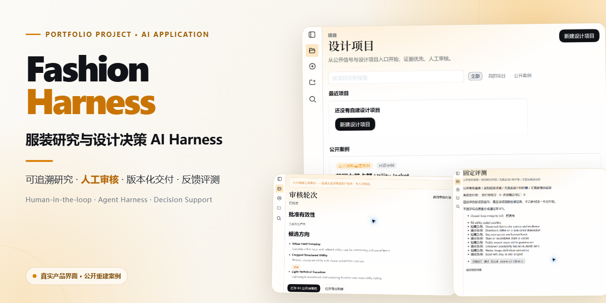
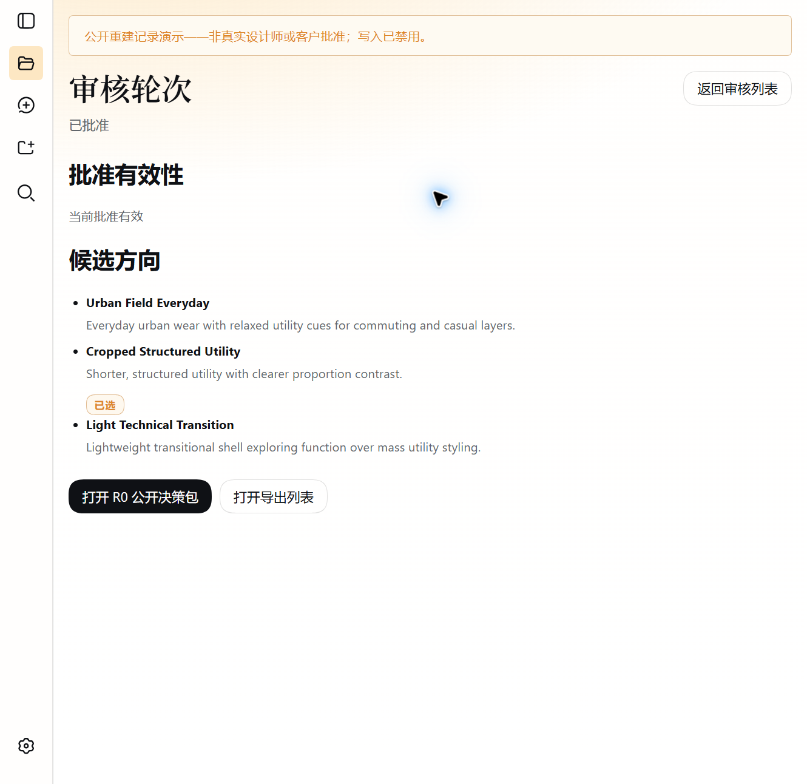

# Fashion Harness

[English](README.md) | 中文

**面向服装研究与设计决策的 AI Harness：让 AI 组织研究证据并提出设计候选，由人完成比较、选择与批准。**

Fashion Harness 将可追溯的研究资料、品牌与设计约束、三个差异化概念方向、人工决策、版本化交付物、反馈和评测记录组织在同一条工作流中。它面向需要检查证据与修订历史的服装设计师，不把 AI 描述成能够替代专业判断的自治系统。

**作品状态：** 2026-10-06 已对冻结应用提交完成独立本地验证：全量构建、typecheck、46 个 Fashion 定向测试文件／284 个测试、全新运行目录启动、HTTP 访问、人工浏览器检查和截图采集均通过；产品限制与仓库限制继续公开披露。

[90 秒阅读路径](#90-second-review-path) · [责任边界](#ownership-and-ai-assisted-implementation) · [本地运行](#run) · [验证证据](docs/fashion/validation-and-evidence.zh.md) · [已知限制](#known-limits)



*项目总览：从可追溯研究和设计约束出发，生成三个候选方向，由人完成审核与批准，并保留版本化交付和评测记录。*

> **独立衍生项目。** 本仓库基于开源 [DeepSeek Harness](https://github.com/deepseek-ai/deepseek-harness) 的 `dsh-v0.1.5-rc.2` 标签／`fb2c4b9e698e30edb738bca4cf0618587db7d203` 提交构建。它不是 DeepSeek 官方项目，与 DeepSeek 不存在合作、背书或隶属关系。详见 [NOTICE.md](NOTICE.md)。

<a id="90-second-review-path"></a>

## 90 秒阅读路径

不必从头读完整个仓库，可以按招聘环节选择入口：

| 读者 | 建议先看 | 可以判断什么 |
| --- | --- | --- |
| 招聘者 | 本页摘要、项目总览图与[当前版本实现](#what-this-version-implements) | 项目解决什么问题、是否形成可见成果、我的角色是否清楚 |
| 用人经理 | [责任边界与 AI 辅助实现](#ownership-and-ai-assisted-implementation)、[为什么它是 Harness](#why-this-is-a-harness-not-a-chat-demo)与[设计决策](#design-decisions-worth-inspecting) | 我如何拆解垂直场景、设计人机协作流程并承担交付责任 |
| 技术面试官 | [架构说明](docs/fashion/architecture.zh.md)、[贡献与归属地图](docs/fashion/contribution-and-ownership.zh.md)、[验证证据](docs/fashion/validation-and-evidence.zh.md)、[本地运行](#run)与[已知限制](#known-limits) | 关键实现在哪里、如何测试和复核、哪些结论仍不能证明 |

需要继续了解产品证据时，可查看[数据来源](docs/fashion/data-provenance-and-limitations.zh.md)、[学习与迭代](docs/fashion/learning-and-iteration.zh.md)和[路线图](docs/fashion/roadmap-and-boundaries.zh.md)。

<a id="ownership-and-ai-assisted-implementation"></a>

## 责任边界与 AI 辅助实现

我负责定义产品问题、业务流程和领域规则，决定项目范围、技术路线、任务规格、验收标准、复核结论和公开边界，并对最终交付负责。

我的工程实践包括阅读上游 monorepo 与 Fashion 模块结构，检查关键代码、数据流和 AI 生成的代码差异；运行 Node.js／pnpm 构建、typecheck、定向测试和本地服务；根据日志、错误、测试结果及人工浏览器操作提出修复要求，并完成回归验证。

Cursor 根据冻结规格承担主要 Fashion 代码实现和测试编写。Codex 协助资料调查、风险分析、任务拆分、验收设计、公开表述校正和独立复核。AI 输出不会自动视为通过：检查失败会进入明确修复，公开表述只覆盖可检查或可复现的事实。

仓库中出现 TypeScript、React、Cordis、Storage 和测试等技术，不代表所有代码均由我独立手写，也不代表我已经完全掌握上游每一部分。完整上游 monorepo 为可复现性而保留；Fashion package、profile 装配和公开作品集材料与上游归属的边界见[架构说明](docs/fashion/architecture.zh.md)和[贡献与归属地图](docs/fashion/contribution-and-ownership.zh.md)。

<a id="what-this-version-implements"></a>

## 当前版本实现了什么

当前公开候选实现了一条可追溯、由人工治理的服装研究与设计决策流程。中文业务动作在前，括号中的英文名称对应代码和存储中的真实对象：

1. **建立设计项目**（`Project`）。
2. **收集研究来源并形成可追溯证据**（`ResearchTask → Source → Sample → Evidence`）。
3. **分析市场信号并确认设计机会**（`MarketItem / PopularitySignal / TrendCluster → DesignOpportunity`）。
4. **固化设计要求并形成三个候选方向**（`DesignOpportunityBrief → ConceptSet → DesignConcept`）。
5. **由人完成比较、选择与批准**（`ReviewRound → ReviewDecision`）。
6. **保存版本化交付物，并记录反馈与结果可用性**（`DesignDeliverable → DesignerFeedback → OutcomeAvailability`）。
7. **执行规则评测，再由人处理改进项**（`EvaluationRun → RuleResult → ImprovementItem`）。

同时包括：

- Fashion 专用运行配置（`fashion` profile）与项目优先的浏览器工作台；
- 项目隔离存储、版本冲突检查（revision check）、只读 R0 公开案例和跨项目保护；
- 将证据区分为“已观察”（`observed`）、“推导所得”（`derived`）和“仍待验证”（`needs_validation`）；
- 只能由人工完成的机会选择、审核、批准与反馈决策；
- 带内容哈希和受众过滤的冻结交付快照；
- 将一次对话会话（`Session`）绑定到一个设计项目（`Project`），并只向 Agent 提供不含 Fashion 写工具的只读项目上下文；
- 确定性评测规则，以及仍需人工分诊的改进队列（`Improvement Queue`）；
- Fashion 运行配置已关闭上游通用欢迎流程；首次启动仍会出现 API Key 引导，但可用“稍后配置”关闭，实时模型动作仍依赖用户配置模型服务（Provider）。

### 代表性成果：三个候选，人工批准



*公开重建案例截图：AI 基于研究证据和设计约束提供三个差异化候选方向，人完成比较、选择与批准。该截图用于演示人机职责，不代表真实设计师或客户批准，也不证明商业效果。*

### 工程验证证据

2026-10-06 对冻结应用提交 `c1a8010b72764876b17744776d674fefc35d4ea9` 完成独立验证：

- 离线使用冻结锁文件安装，并完成应用全量构建（252 个客户端产物）；
- typecheck 通过；
- 46 个 Fashion 定向测试文件／284 个测试通过；
- 使用全新、隔离的 `DSH_HOME` 启动，页面返回 HTTP 200；
- 完成人工浏览器主链检查，并采集六张证据截图。

全仓 translation-pairing 与 Markdown 链接检查仍会报告保留的上游文档链接债务，不应写成全仓所有检查通过，也不代表 Fashion 运行失败。完整命令、结果和证据边界见[验证与证据](docs/fashion/validation-and-evidence.zh.md)。

<a id="why-this-is-a-harness-not-a-chat-demo"></a>

## 为什么它是 Harness，而不是聊天 Demo

聊天 Demo 主要验证模型能否回答一次问题；Fashion Harness 关注的是一项服装研究与设计决策如何跨多个步骤持续推进、接受检查并保留责任记录。对话只是操作入口之一，项目记录才是业务事实来源。

它将研究证据、设计约束、候选方案、人工决定、版本化交付物、反馈和评测保存在同一项目流程中：AI 可以整理信息并提出建议，但机会选择、审核、批准和改进项处理仍由人完成；失败不会被自动掩盖，而会进入可检查的修复与复核过程。

技术实现使用持久化领域状态、可替换的模型服务（Provider）、受限工具权限、来源记录、版本冲突检查（revision check）和确定性评测。首版只向 Agent 提供可观察、只读的项目上下文，不声称已经完成自治多 Agent 系统。未来是否拆分研究、设计和评测 Agent，取决于上下文隔离、职责归属和评测证据，而不是为了展示复杂度。

## 已实现流程演示（合成数据）

[查看完整中文流程演示](examples/fashion-fictional-walkthrough/README.zh.md)：它使用稳定的合成业务数据，展示已经在 Fashion Harness 中实现的研究证据、设计机会、三个候选方向、人工批准、版本化交付和评测流程。

这里“合成”的是案例中的团队、业务背景、人物、URL 和数值，不是产品实现。对应功能已有定向测试、独立本地验证和人工浏览器主链检查支撑，详见[验证与证据](docs/fashion/validation-and-evidence.zh.md)；这份说明文档本身不是可导入测试数据（fixture），也不能证明真实客户采用、市场预测或商业效果。仓库内置的 R0 公开案例与之不同：R0 是带日期和来源链接的只读公开资料重建。

<a id="run"></a>
<a id="run-from-source"></a>

## 从源码运行

需要与上游仓库兼容的 Node.js 和 pnpm 版本。

```sh
pnpm install --frozen-lockfile
pnpm run build
pnpm dsh --profile fashion
```

Web 服务默认使用 `http://127.0.0.1:3080`。评估仓库时建议使用隔离的 `DSH_HOME`，避免本机设置、凭据、会话和存储相互影响。

确定性的 Fashion 工作台设计为无需 API Key 即可浏览。实时 Agent／模型动作需要通过 Models 设置页或启动环境配置 Provider。不要提交凭据；[`.env.example`](.env.example) 只包含变量名。

> 这条运行路径已于 2026-10-06 使用冻结应用提交、离线冻结锁文件安装和全新 `DSH_HOME` 完成独立验证。准确结果与已披露失败见[验证与证据](docs/fashion/validation-and-evidence.zh.md)。

<a id="design-decisions-worth-inspecting"></a>

## 值得检查的设计决策

- **证据先于结论：** 来源、样本、ClaimType、审核状态和限制保持可查看。
- **人工权威进入领域状态：** 选择、批准、拒绝和反馈不是一句对话，而是正式记录。
- **Revision 正确性：** 写操作携带 expected revision；陈旧决策和 artifact 会被拒绝或标记失效。
- **只读 Agent 边界：** 模型读取绑定项目的紧凑快照，不能传入任意 Project ID，也不能修改 Fashion storage。
- **如实处理结果：** `unavailable` 和 `not_authorized` 不会被换算成 0；结果记录保留来源和验证状态。
- **评测不等于自动修复：** 失败规则可以生成 ImprovementItem，但只能由人工接受、规划、解决或拒绝。

<a id="known-limits"></a>

## 已知限制

- 部分分析 `subjectRefs`／`memberRefs` 尚未完成全面的对象存在性与项目归属验证。
- 已有 Brief 创建和确认，但没有完整的产品级 Brief 修订界面。
- Improvement 候选需要人工分诊，不会自动修复，也不与所有后续上游状态保持强一致。
- 部分 Evaluation 仓库证据依赖 Git checkout。
- R0 数据量小、带日期且不具代表性，不是实时市场数据或销量预测。
- 不声称已经完成完整 Fashion Dataset、生产级 Ontology、服装垂类模型、CAD／Tech Pack 管线或商业效果。
- 真实设计师可用性和价值属于计划中的 R1；当前没有满意度或效率结果。
- 全仓 translation-pairing 与 Markdown 链接检查仍因保留的上游文档指向已排除内部路径而失败；新增 Fashion 公开材料没有产生这些失败。

## 文档导航

- [Fashion 文档索引](docs/fashion/README.zh.md)
- [产品案例](docs/fashion/product-case-study.zh.md)
- [架构与归属图](docs/fashion/architecture.zh.md)
- [贡献与归属地图](docs/fashion/contribution-and-ownership.zh.md)
- [开发流程与 AI 协作](docs/fashion/development-process.zh.md)
- [验证与证据](docs/fashion/validation-and-evidence.zh.md)
- [数据来源与限制](docs/fashion/data-provenance-and-limitations.zh.md)
- [学习与迭代](docs/fashion/learning-and-iteration.zh.md)
- [路线图与边界](docs/fashion/roadmap-and-boundaries.zh.md)

## 许可与归属

仓库保留上游 MIT 许可和适用的版权声明，Fashion 新增部分同样按 MIT 提供。外部网页、品牌名、报告和链接内容仍归各自权利人所有，不因本仓库许可而被重新许可。参见 [LICENSE](LICENSE)、[NOTICE.md](NOTICE.md)、[THIRD_PARTY_NOTICES.md](THIRD_PARTY_NOTICES.md) 和保留的 [DeepSeek Harness 品牌指南](BRAND_GUIDELINES.zh.md)。
