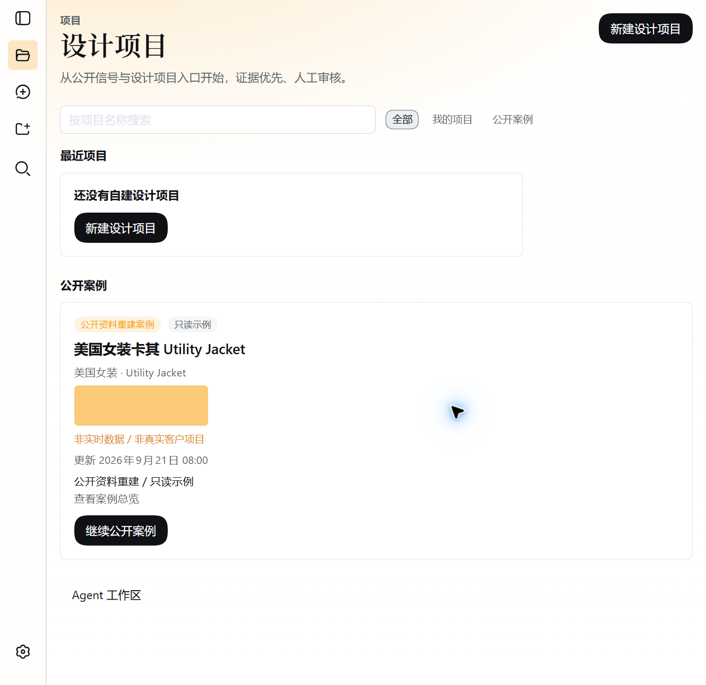

# Fashion Harness

[English](README.md) | 中文

**基于 DeepSeek Harness 构建的可追溯服装研究与设计决策工作台。**

Fashion Harness 把小规模、可归属的研究资料组织为可审核的设计机会、三个差异化概念方向、人工决策、版本化交付物、反馈与评测记录。它服务于需要检查证据和修订历史的服装设计师，不把 AI 描述成可以替代专业判断的自治系统。

**作品状态：** 2026-10-06 已对冻结应用提交完成独立本地验证：全量构建、typecheck、46 个 Fashion 定向测试文件／284 个测试、全新运行目录启动、HTTP 访问、人工浏览器检查和截图采集均通过；产品限制与仓库限制继续公开披露。

[90 秒阅读路径](#90-second-review-path) · [责任边界](#ownership-and-ai-assisted-implementation) · [本地运行](#run) · [验证证据](docs/fashion/validation-and-evidence.zh.md) · [已知限制](#known-limits)



> **独立衍生项目。** 本仓库基于开源 [DeepSeek Harness](https://github.com/deepseek-ai/deepseek-harness) 的 `dsh-v0.1.5-rc.2` 标签／`fb2c4b9e698e30edb738bca4cf0618587db7d203` 提交构建。它不是 DeepSeek 官方项目，与 DeepSeek 不存在合作、背书或隶属关系。详见 [NOTICE.md](NOTICE.md)。

<a id="90-second-review-path"></a>

## 90 秒阅读路径

| 时间 | 查看内容 | 能力证据 |
| --- | --- | --- |
| 前 15 秒 | 留在本页阅读摘要并查看截图 | 产品问题与可见结果 |
| 35 秒内 | [当前版本实现了什么](#what-this-version-implements) | 当前业务闭环与已验证工程切片 |
| 55 秒内 | [责任边界与 AI 辅助实现](#ownership-and-ai-assisted-implementation) | 我决定了什么、AI 实现了什么、哪些内容仍归上游所有 |
| 75 秒内 | [为什么它是 Harness](#why-this-is-a-harness-not-a-chat-demo)与[设计决策](#design-decisions-worth-inspecting) | 系统边界、人工权威、来源、revision 与评测选择 |
| 90 秒内 | [已知限制](#known-limits)与本页验证摘要 | 展示交付证据，但不把规划或测试包装成夸大的能力声明 |

如果进入面试深度，可继续查看[数据来源](docs/fashion/data-provenance-and-limitations.zh.md)、[学习与迭代](docs/fashion/learning-and-iteration.zh.md)和[路线图](docs/fashion/roadmap-and-boundaries.zh.md)。

<a id="ownership-and-ai-assisted-implementation"></a>

## 责任边界与 AI 辅助实现

我负责产品问题、业务流程和领域决策，决定范围、技术路线、验收标准、任务组织、复核结论和公开边界，并以能够解释、修改、调试和验证为实践目标。

Cursor 根据冻结规格承担主要代码实现和测试编写。Codex 协助资料调查、风险分析、任务拆分、验收设计和独立复核。AI 输出不会自动视为通过：检查失败会进入明确修复，公开表述只覆盖可检查或可复现的事实。

仓库中存在 TypeScript、React、Cordis、Storage 和测试等技术，不代表我独立手写或完全掌握上游每一部分。完整上游 monorepo 为可复现性而保留；Fashion package、profile 装配和公开作品集材料与上游归属的边界见[架构说明](docs/fashion/architecture.zh.md)和[贡献与归属地图](docs/fashion/contribution-and-ownership.zh.md)。

<a id="what-this-version-implements"></a>

## 当前版本实现了什么

本地公开候选包含一条确定性、由人工治理的工作流：

```text
Project
→ ResearchTask → Source → Sample → Evidence
→ MarketItem / PopularitySignal / TrendCluster → DesignOpportunity
→ DesignOpportunityBrief → ConceptSet → three DesignConcepts
→ ReviewRound / ReviewDecision
→ versioned DesignDeliverable
→ DesignerFeedback / OutcomeAvailability
→ EvaluationRun / RuleResult / ImprovementItem
```

同时包括：

- Fashion 专用 profile 与项目优先的浏览器工作台；
- 项目域存储、revision 检查、只读 R0 和跨项目保护；
- 区分 `observed`、`derived`、`needs_validation` 的证据状态；
- 只能由人工完成的机会选择、审核、批准与反馈决策；
- 带内容哈希和受众过滤的冻结交付快照；
- 将一个 Session 绑定到一个 Project、且不提供 Fashion 写工具的只读 Agent 上下文；
- 确定性评测规则，以及仍需人工分诊的 Improvement Queue；
- Fashion profile 已配置为关闭上游通用欢迎流程；首次启动仍会出现 API Key 引导，但可用“稍后配置”关闭，实时模型动作仍依赖用户配置 Provider。

2026-10-06 已对冻结应用提交 `c1a8010b72764876b17744776d674fefc35d4ea9` 完成独立验证，包括离线冻结锁文件安装、全量构建（252 个客户端产物）、typecheck、46 个 Fashion 定向测试文件／284 个测试、全新 `DSH_HOME` 启动、页面 HTTP 200、人工浏览器主链检查和六张证据截图。全仓 translation-pairing 与 Markdown 链接门禁仍会报告：部分保留的上游文档链接指向候选包主动排除的 `.agents`／`.github` 内容；这是已披露的文档债务，不应被写成 Fashion 运行失败或全仓通过。

<a id="why-this-is-a-harness-not-a-chat-demo"></a>

## 为什么它是 Harness，而不是聊天 Demo

核心价值不在一条 Prompt 或一张生成图片，而在于协调持久化领域状态、可替换 Provider、工具权限、人工门禁、来源、revision 与评测。Conversation 只是工作区界面之一，不是业务事实源。

首版有意采用一个可观察、只读的 Agent 上下文，不声称已经完成自治多 Agent 系统。未来是否拆分 Research、Design 和 Evaluation Agent，取决于上下文隔离、职责归属和评测证据，而不是为了展示复杂度。

## 公开演练

[`examples/fashion-fictional-walkthrough/`](examples/fashion-fictional-walkthrough/README.zh.md) 提供稳定的虚构演练。它沿用当前领域术语，但不是可导入 fixture、真实客户案例、市场预测或商业效果证明。

内置 R0 案例与之不同：R0 是带日期和链接的只读公开资料重建。易变或未复核的价格、折扣、库存和数量不会被表达为当前已确认事实。

<a id="run"></a>
<a id="run-from-source"></a>

## 从源码运行

需要与上游仓库兼容的 Node.js 和 pnpm 版本。

```sh
pnpm install --frozen-lockfile
pnpm run build
pnpm dsh --profile fashion
```

Web 服务默认使用 `http://127.0.0.1:3080`。评估仓库时建议使用隔离的 `DSH_HOME`，避免本机设置、凭据、会话和存储相互影响。

确定性的 Fashion 工作台设计为无需 API Key 即可浏览。实时 Agent／模型动作需要通过 Models 设置页或启动环境配置 Provider。不要提交凭据；[`.env.example`](.env.example) 只包含变量名。

> 这条运行路径已于 2026-10-06 使用冻结应用提交、离线冻结锁文件安装和全新 `DSH_HOME` 完成独立验证。准确结果与已披露失败见[验证与证据](docs/fashion/validation-and-evidence.zh.md)。

<a id="design-decisions-worth-inspecting"></a>

## 值得检查的设计决策

- **证据先于结论：** 来源、样本、ClaimType、审核状态和限制保持可查看。
- **人工权威进入领域状态：** 选择、批准、拒绝和反馈不是一句对话，而是正式记录。
- **Revision 正确性：** 写操作携带 expected revision；陈旧决策和 artifact 会被拒绝或标记失效。
- **只读 Agent 边界：** 模型读取绑定项目的紧凑快照，不能传入任意 Project ID，也不能修改 Fashion storage。
- **如实处理结果：** `unavailable` 和 `not_authorized` 不会被换算成 0；结果记录保留来源和验证状态。
- **评测不等于自动修复：** 失败规则可以生成 ImprovementItem，但只能由人工接受、规划、解决或拒绝。

<a id="known-limits"></a>

## 已知限制

- 部分分析 `subjectRefs`／`memberRefs` 尚未完成全面的对象存在性与项目归属验证。
- 已有 Brief 创建和确认，但没有完整的产品级 Brief 修订界面。
- Improvement 候选需要人工分诊，不会自动修复，也不与所有后续上游状态保持强一致。
- 部分 Evaluation 仓库证据依赖 Git checkout。
- R0 数据量小、带日期且不具代表性，不是实时市场数据或销量预测。
- 不声称已经完成完整 Fashion Dataset、生产级 Ontology、服装垂类模型、CAD／Tech Pack 管线或商业效果。
- 真实设计师可用性和价值属于计划中的 R1；当前没有满意度或效率结果。
- 全仓 translation-pairing 与 Markdown 链接检查仍因保留的上游文档指向已排除内部路径而失败；新增 Fashion 公开材料没有产生这些失败。

## 文档导航

- [Fashion 文档索引](docs/fashion/README.zh.md)
- [产品案例](docs/fashion/product-case-study.zh.md)
- [架构与归属图](docs/fashion/architecture.zh.md)
- [贡献与归属地图](docs/fashion/contribution-and-ownership.zh.md)
- [开发流程与 AI 协作](docs/fashion/development-process.zh.md)
- [验证与证据](docs/fashion/validation-and-evidence.zh.md)
- [数据来源与限制](docs/fashion/data-provenance-and-limitations.zh.md)
- [学习与迭代](docs/fashion/learning-and-iteration.zh.md)
- [路线图与边界](docs/fashion/roadmap-and-boundaries.zh.md)

## 许可与归属

仓库保留上游 MIT 许可和适用的版权声明，Fashion 新增部分同样按 MIT 提供。外部网页、品牌名、报告和链接内容仍归各自权利人所有，不因本仓库许可而被重新许可。参见 [LICENSE](LICENSE)、[NOTICE.md](NOTICE.md)、[THIRD_PARTY_NOTICES.md](THIRD_PARTY_NOTICES.md) 和保留的 [DeepSeek Harness 品牌指南](BRAND_GUIDELINES.zh.md)。
