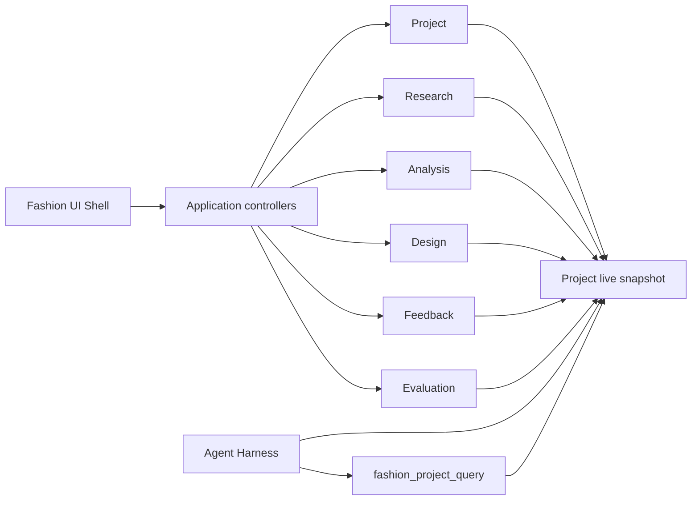

# System Architecture

English | [中文](architecture.zh.md)

## 1. Current architecture slice

Fashion Harness is an independent derivative of DeepSeek Harness. The current slice combines domain packages, application controllers, a Fashion UI Shell, and a Fashion App Bundle.

The code is organized into 16 Fashion packages: seven domain packages, seven corresponding controllers, one `ui-fashion-shell`, and one `fashion-app` bundle. Fashion packages use the independent `@gentlexx/*` namespace and remain `private: true`.

## 2. Domain layers

| Layer | Core objects | Responsibility |
| --- | --- | --- |
| Project | Project registry and R0 | Durable project boundary; R0 is a read-only seed |
| Research | `ResearchTask`, `Source`, `Sample`, `Evidence` | Sources, samples, evidence, and human-review state |
| Analysis | `MarketItem`, `AttributeAssertion`, `PopularitySignal`, `AnalysisRun`, `TrendCluster`, `DesignOpportunity` | Analysis results and design opportunities from traceable input |
| Design | `DesignOpportunityBrief`, `ConceptSet`, `DesignConcept`, `ReviewRound`, `DesignDeliverable` | Versioned concepts, review, approval invalidation, and delivery |
| Feedback | `DesignerFeedback`, `OutcomeAvailability`, `DevelopmentEvent`, `OutcomeMetricObservation` | Subjective feedback, development events, and observable outcomes |
| Evaluation | `EvaluationDefinition`, `EvaluationCase`, `EvaluationRun`, `RuleResult`, `HumanAssessment`, `ImprovementItem` | Rules, human assessment, and improvement candidates |
| Agent | Session binding, snapshot injection, read-only tool | Controlled access to project facts for the Agent |

## 3. Agent/Harness boundary

The current Harness is not an autonomous agent with arbitrary write access. It injects a compact live project snapshot before execution and exposes the read-only `fashion_project_query`. The caller selects only a section; `projectId` comes from the Host-managed Project–Session binding, preventing the model from selecting another project.

Fashion writes are owned by application controllers and domain rules. No public Fashion write tools exist, so the repository does not claim a fully autonomous multi-agent workflow.

## 4. Key invariants

- concept generation binds to the exact revision of the selected `DesignOpportunity`;
- `review_ready` requires exactly three pairwise-differentiated concepts;
- approval binds to the current selection, and a content change creates `ApprovalInvalidation`;
- a `DesignDeliverable` requires an approval that remains valid;
- snapshots use JCS canonicalization and a SHA-256 digest for verification;
- `public_portfolio` is an export audience, not automatic publication.

## 5. Current versus long-term architecture

The current implementation is `Brief → small traceable research → design opportunities → three concept directions → human review → delivery and evaluation records`.

A complete Fashion Dataset, Fashion Ontology, automated compliant collection, multi-model routing, an image/video production line, professional CAD/Tech Pack integration, real market-outcome feedback, and vertical-model training are all **Planned**, not implemented.
