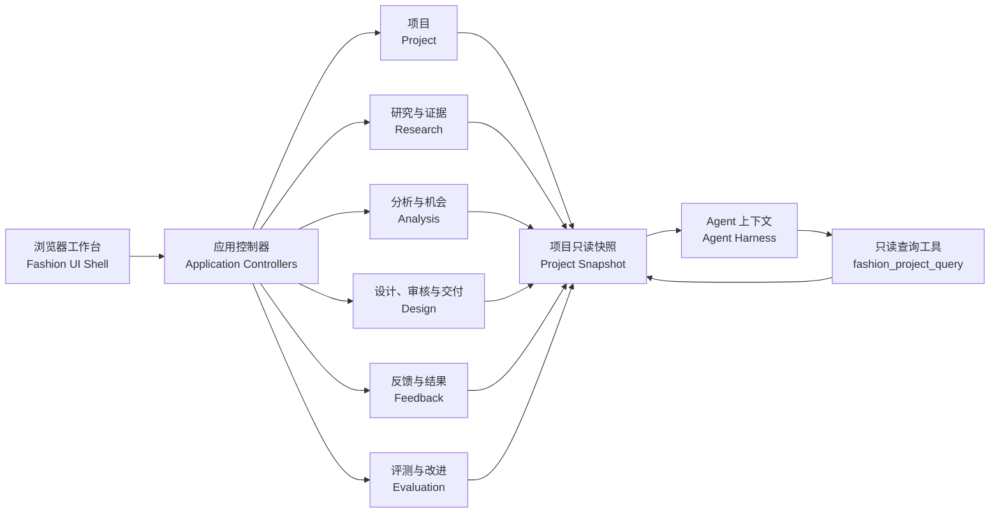

# 系统架构

[English](architecture.md) | 中文

## 1. 当前架构切片

Fashion Harness 作为 DeepSeek Harness 的独立衍生工程，以领域包、应用控制器、Fashion UI Shell 和 Fashion App Bundle 组成当前切片。

代码按 16 个 Fashion package 组织：七个领域包、七个对应 controller、一个 `ui-fashion-shell` 和一个 `fashion-app` bundle。Fashion package 使用独立的 `@gentlexx/*` 命名空间，并保持 `private: true`。

架构中有两条职责不同的路径：设计师或项目操作者通过 UI、Controller 和领域规则创建或修改业务对象；Agent 从绑定项目的快照与查询工具读取事实，用于辅助理解和建议。两条路径共享同一组项目对象，但写入权限和人工责任保持分离。

## 2. 领域分层

| 层 | 核心对象 | 主要职责 |
| --- | --- | --- |
| Project | 项目注册与 R0 | 提供持久项目边界；R0 为只读种子 |
| Research | `ResearchTask`、`Source`、`Sample`、`Evidence` | 保存来源、样本、证据及人工复核状态 |
| Analysis | `MarketItem`、`AttributeAssertion`、`PopularitySignal`、`AnalysisRun`、`TrendCluster`、`DesignOpportunity` | 从可追溯输入形成分析结果和设计机会 |
| Design | `DesignOpportunityBrief`、`ConceptSet`、`DesignConcept`、`ReviewRound`、`DesignDeliverable` | 版本化概念、审核、批准失效与交付 |
| Feedback | `DesignerFeedback`、`OutcomeAvailability`、`DevelopmentEvent`、`OutcomeMetricObservation` | 区分主观反馈、开发事件和可观察结果 |
| Evaluation | `EvaluationDefinition`、`EvaluationCase`、`EvaluationRun`、`RuleResult`、`HumanAssessment`、`ImprovementItem` | 保存规则检查、人工评估和改进候选 |
| Agent | Session 绑定、快照注入、只读工具 | 把项目事实以受控方式提供给 Agent |

## 3. Agent/Harness 权限设计

一期 Harness 采用项目绑定的只读策略：执行前注入紧凑的项目实时快照，并提供 `fashion_project_query` 查询工具。工具调用者只选择查询 section；`projectId` 来自宿主保存的 Project–Session 绑定，从结构上限制模型自行指定项目或跨项目读取。

Fashion 领域的写入统一经过应用控制器、领域规则和人工审核节点。后续增加写工具或按职责拆分 Agent 前，需要先具备最小权限、操作审计、失败恢复和人工批准机制；当前版本聚焦可观察、可复核的辅助决策。

## 4. 关键不变量

- 概念生成绑定到被选中的 `DesignOpportunity` 精确版本；
- `review_ready` 要求恰好三个、两两有区分度的概念；
- 批准绑定当前选择，内容变化会触发 `ApprovalInvalidation`；
- `DesignDeliverable` 只能基于仍然有效的批准生成；
- 快照使用 JCS 规范化与 SHA-256 摘要，便于校验交付依据；
- `public_portfolio` 表示交付物的导出目标分类；真正公开或上传仍由明确的人工操作决定。

## 5. 当前架构切片与扩展方向

当前架构已经支持以下闭环：

**设计需求**（Brief） 
↓ 
**小规模可追溯研究**（Traceable Research） 
↓ 
**趋势与设计机会**（Trend Cluster / Design Opportunity） 
↓ 
**三个差异化设计方向**（Three Design Concepts） 
↓ 
**人工审核与版本变更**（Human Review / Revision） 
↓ 
**版本化交付与评测记录**（Versioned Deliverable / Evaluation Record）

完整 Fashion Dataset、Fashion Ontology、自动化合规采集、多模型路由、图像／视频生产线、专业 CAD／Tech Pack、真实结果回流和垂直模型训练属于后续扩展方向。它们将依据数据授权、设计师试用、评测证据和工程稳定性分阶段进入，具体状态见[路线图与项目状态](roadmap-and-boundaries.zh.md)。

需要从业务问题继续追到源码和测试时，可查看[贡献、归属与关键代码地图](contribution-and-ownership.zh.md#3-fashion-专属代码地图)。
