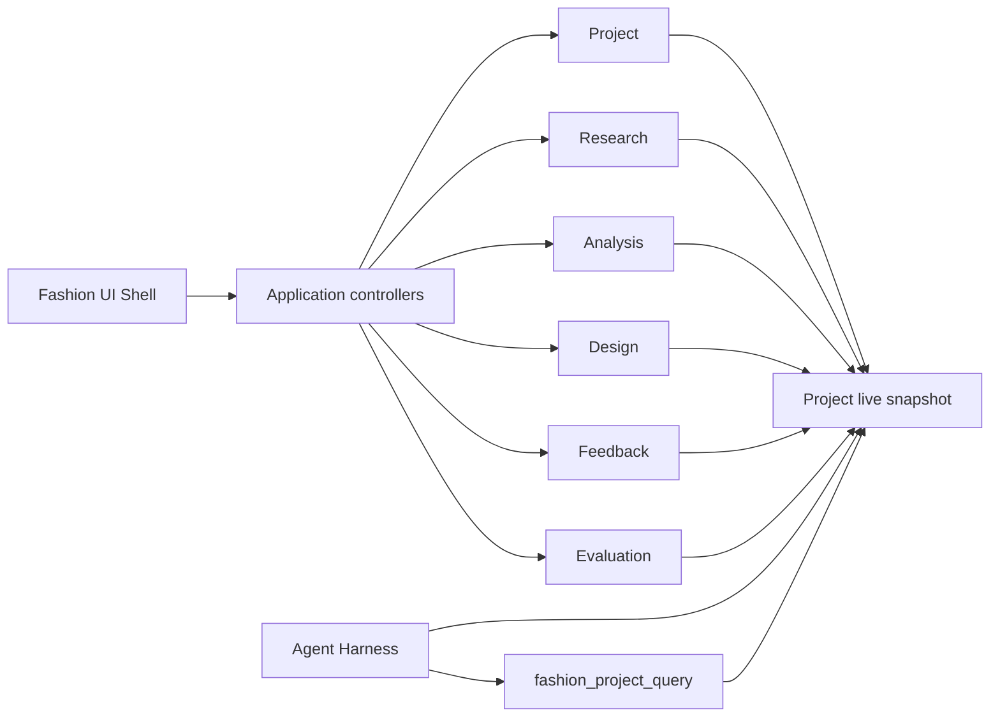

# 系统架构

[English](architecture.md) | 中文

## 1. 当前架构切片

Fashion Harness 作为 DeepSeek Harness 的独立衍生工程，以领域包、应用控制器、Fashion UI Shell 和 Fashion App Bundle 组成当前切片。

代码按 16 个 Fashion package 组织：七个领域包、七个对应 controller、一个 `ui-fashion-shell` 和一个 `fashion-app` bundle。Fashion package 使用独立的 `@gentlexx/*` 命名空间，并保持 `private: true`。

## 2. 领域分层

| 层 | 核心对象 | 主要职责 |
| --- | --- | --- |
| Project | 项目注册与 R0 | 提供持久项目边界；R0 为只读种子 |
| Research | `ResearchTask`、`Source`、`Sample`、`Evidence` | 保存来源、样本、证据及人工复核状态 |
| Analysis | `MarketItem`、`AttributeAssertion`、`PopularitySignal`、`AnalysisRun`、`TrendCluster`、`DesignOpportunity` | 从可追溯输入形成分析结果和设计机会 |
| Design | `DesignOpportunityBrief`、`ConceptSet`、`DesignConcept`、`ReviewRound`、`DesignDeliverable` | 版本化概念、审核、批准失效与交付 |
| Feedback | `DesignerFeedback`、`OutcomeAvailability`、`DevelopmentEvent`、`OutcomeMetricObservation` | 区分主观反馈、开发事件和可观察结果 |
| Evaluation | `EvaluationDefinition`、`EvaluationCase`、`EvaluationRun`、`RuleResult`、`HumanAssessment`、`ImprovementItem` | 保存规则检查、人工评估和改进候选 |
| Agent | Session 绑定、快照注入、只读工具 | 把项目事实以受控方式提供给 Agent |

## 3. Agent/Harness 边界

当前 Harness 不是一个拥有任意写权限的自动代理。它在执行前注入紧凑的项目实时快照，并提供只读的 `fashion_project_query`。工具调用者只能选择查询 section；`projectId` 来自宿主保存的 Project–Session 绑定，避免模型自行指定或跨项目读取。

Fashion 领域的写入由应用控制器和领域规则管理。当前没有公开的 Fashion 写工具，因此仓库不声称已经实现全自动多 Agent 执行。

## 4. 关键不变量

- 概念生成绑定到被选中的 `DesignOpportunity` 精确版本；
- `review_ready` 要求恰好三个、两两有区分度的概念；
- 批准绑定当前选择，内容变化会触发 `ApprovalInvalidation`；
- `DesignDeliverable` 只能基于仍然有效的批准生成；
- 快照使用 JCS 规范化与 SHA-256 摘要，便于校验交付依据；
- `public_portfolio` 仅代表一种导出目标，不等于自动公开或上传。

## 5. 当前与长期架构的边界

当前实现是 `Brief → 小规模可追溯研究 → 趋势机会 → 三个设计方向 → 人工审核 → 交付与评估记录`。

完整的 Fashion Dataset、Fashion Ontology、自动化合规采集、多模型路由、图像/视频生产线、专业 CAD/Tech Pack、真实市场结果回流和垂直模型训练均为 **Planned**，不属于当前实现。
